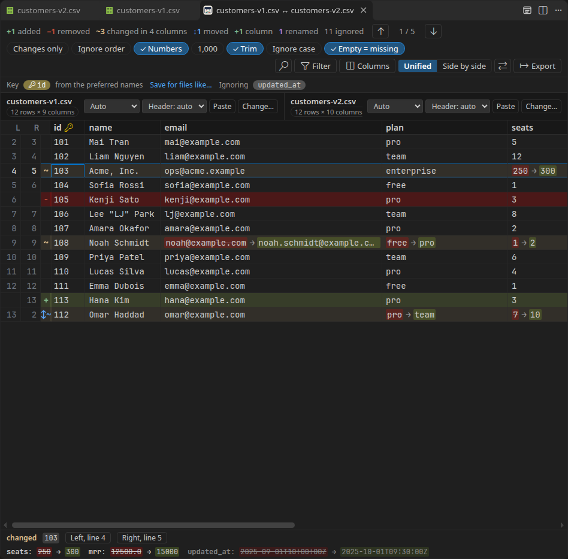
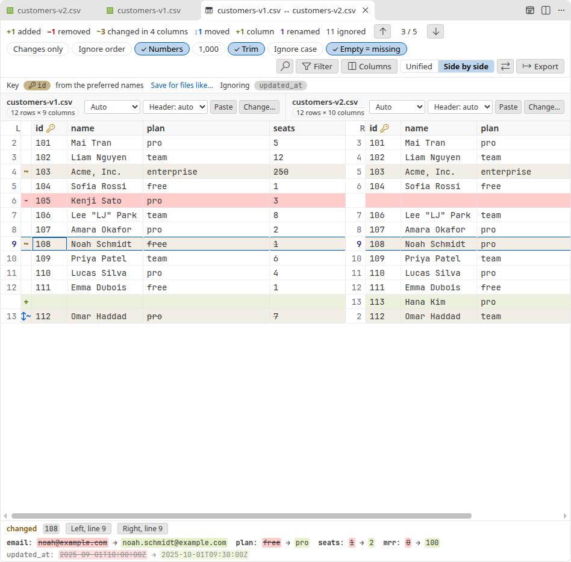
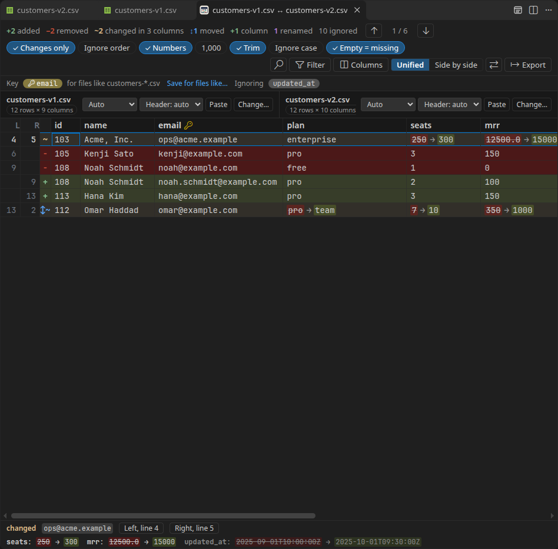

<h1 align="center">
  <br>
  CSV Semantic Diff
</h1>

<p align="center">
  Compare two CSV or TSV files by what they mean, not line by line.
</p>

<p align="center">
  <a href="https://github.com/heyliamme/csv-semantic-diff/blob/main/CHANGELOG.md">Changelog</a> ·
  <a href="https://github.com/heyliamme/csv-semantic-diff/blob/main/CONTRIBUTING.md">Contributing</a> ·
  <a href="https://marketplace.visualstudio.com/items?itemName=heyliam.json-semantic-diff">JSON Semantic Diff</a>
</p>



A text diff of two CSV exports is mostly noise. Sort the rows differently, move a
column, quote a value, write `1200` as `1.2e3`, and every line lights up. This
extension reads both files as tables and compares the rows:

- **Rows are matched by a key column**, so an inserted row doesn't make every row
  after it look changed, and a sorted export compares clean. The key is found for you
  (`id`, `uuid`, `sku`, `email`, … or any column that is unique on both sides, or a pair
  of columns) and can be changed with one click.
- **Row order, column order, quoting and number spelling don't matter.** `1.0` equals
  `1`, `"Acme, Inc."` equals `Acme, Inc.`, and a column that moved left is still the same
  column. Rows that only changed place are shown as moved and counted separately.
- **Columns are matched too.** An added or removed column is one change, not a change in
  every row, and a column renamed from `country` to `region` is shown as a rename.
- **Every changed cell shows old → new**, in a unified table or side by side, with a
  footer that spells out the changes of the selected row in full.
- **Big files are fine.** 100,000 rows by 20 columns per side compare in under two
  seconds, in a worker thread; the table only builds the rows on screen.
- **Takes what you have.** Comma, tab, semicolon or pipe delimiters are detected (and can
  be set per side), as are header rows; RFC 4180 quoting with embedded line breaks, CRLF,
  a byte order mark and ragged rows are all read correctly.

## Install

From the [Visual Studio Marketplace](https://marketplace.visualstudio.com/items?itemName=heyliam.csv-semantic-diff),
from [Open VSX](https://open-vsx.org/extension/heyliam/csv-semantic-diff) (VSCodium, Cursor
and other editors), or from a terminal:

```bash
code --install-extension heyliam.csv-semantic-diff
```

## Getting started

Open a CSV or TSV file and press <kbd>Ctrl</kbd>+<kbd>K</kbd> <kbd>C</kbd>
(<kbd>Cmd</kbd>+<kbd>K</kbd> <kbd>C</kbd> on macOS), then choose what to compare it with:
another open file, a file on disk, or the clipboard.

| To compare | Do this |
| --- | --- |
| The current file with another one | <kbd>Ctrl</kbd>+<kbd>K</kbd> <kbd>C</kbd>, or **Compare with…** in the editor's context menu |
| The current file, or selected rows, with the clipboard | <kbd>Ctrl</kbd>+<kbd>K</kbd> <kbd>Shift</kbd>+<kbd>C</kbd> |
| Two files in the Explorer | Select both, right-click, **Compare as CSV** |
| Two files, one at a time | **Select for CSV Compare** on the first, **Compare as CSV with Selected** on the second |
| Your working copy with the last commit | **Compare with HEAD** |
| Your working copy with any commit, branch or tag | **Compare with Git Revision…** (lists the commits that changed the file) |
| The two sides of a diff editor (Source Control, a pull request, Timeline) | <kbd>Ctrl</kbd>+<kbd>K</kbd> <kbd>C</kbd>, or the table button in the editor title |
| Two tables you paste | The table button in the title bar of a CSV editor, or <kbd>Ctrl</kbd>+<kbd>K</kbd> <kbd>Alt</kbd>+<kbd>C</kbd> (**New CSV Comparison**) |

All commands are under **CSV Semantic Diff** in the Command Palette. To change a
shortcut, search for `csvSemanticDiff` in **Keyboard Shortcuts**. <kbd>Ctrl</kbd>+<kbd>K</kbd>
<kbd>C</kbd> applies in CSV and TSV editors only; elsewhere it stays VS Code's own
**Compare Active File with Clipboard**. Files ending in `.csv`, `.tsv`, `.tab` and `.psv`
are offered in the editor and Explorer menus, `.txt` files in the Explorer menu (and in
the editor menu when text is selected); any text works through the commands.

## In the comparison



- **Step through changes** with the arrows, <kbd>F7</kbd> / <kbd>Shift</kbd>+<kbd>F7</kbd>,
  or <kbd>N</kbd> / <kbd>P</kbd>.
- **Click a row** to see every change in it in full in the footer, with buttons to open
  either file at that row. **Double-click** or <kbd>Enter</kbd> opens the file.
- **Key**: the chip in the bar says which column identifies a row and how it was chosen.
  Click it to pick another column, several columns for a composite key, none to align
  rows by content, or **Automatic** to go back to the key found for you (also a link next
  to the chip). **Save for files like…** remembers the choice for files with that name
  pattern (`orders*.csv`).
- A **column's header menu** can hide the column, ignore its differences (timestamps,
  counters), use it as the key (or add it to the current one), filter to rows changed in it, or search in it.
- **Changes only** hides unchanged rows; **Filter** narrows by status or by the column
  that changed; **Columns** shows and hides columns.
- **Find** with <kbd>Ctrl</kbd>+<kbd>F</kbd>: text or a regular expression, in any column
  or one, with **Only matches** to keep just the matching rows.
- **Unified** shows one table with old → new in changed cells; **Side by side** shows
  each file in its own column order with the rows aligned.
- **Ignore order**, **Numbers**, **1,000**, **Trim**, **Ignore case** and **Empty = missing**
  switch the comparison rules for this view (see below).
- **Export**: **Copy as Markdown** puts the summary and the changed rows on the
  clipboard as a table, ready for a pull request; **Save highlighter CSV** writes the
  comparison in [daff](https://github.com/paulfitz/daff)'s format (`+++`, `---`, `->`
  in the first column, `old->new` in changed cells); **Save as JSON** writes a
  machine-readable version. Cells that a spreadsheet would run as formulas are defused
  in the CSV export; in Markdown every value is an inline code span, so nothing in the
  data becomes a mention, a link, an image or HTML when it is pasted.
- **Paste** replaces a side with the clipboard, **Change…** with a file or an open
  editor, and the delimiter and header-row selects next to each file name override
  what was detected.

The view follows the files: edit or save either one and the comparison updates.



## How rows are matched

1. Columns are paired by name (exactly, then ignoring case). A column left over on each
   side whose values mostly reappear under the other name is treated as renamed; for a
   column with few distinct values (true/false, a status) the names must be related too
   (`active` → `is_active`).
2. The key is the first name in `csvSemanticDiff.keyColumns` that exists on both sides,
   is never empty, and is unique on each side (`a+b` names a composite key). A key saved
   for the file name (`csvSemanticDiff.keysByFile`) or chosen in the view wins over it.
3. Without one, any column that is unique and never empty on both sides is tried,
   preferring the one that shares the most values, then pairs of the first ten columns.
4. Without any key, rows are aligned by content: the longest run of identical rows is
   kept in place, a removed row that reappears elsewhere is a move, and a removed and
   an added row that mostly agree (weighted by how telling each column is) pair up as
   one edited row. The bar says when this happens.

Key values are compared as text (trimmed, and without case when **Ignore case** is on),
never as numbers: `1.1` and `1.10` are different sections. Repeated keys are matched in
order of appearance, with a warning.

Both sides read their first row the same way: when the header row is detected on one
side and not on the other (the rows below differ), the side without one follows, as
long as its first row could be column names. Setting the header row by hand on one side
sets it for the other side too, unless that side was set by hand as well. pandas'
unnamed index column is a header cell too, and so is the empty last name a trailing
delimiter leaves. Blank rows (`,,`, or only spaces) are skipped; a quoted empty value
(`""`) is a value, not a blank row.

A column that only numbers the rows (0, 1, 2… or 1, 2, 3… top to bottom on both sides,
such as a pandas index or `#`) is not taken as the key automatically: pairing by it
would pair rows by position.

## Normalisation

| Rule | Default | What it does |
| --- | --- | --- |
| Numbers | on | `1`, `1.0`, `1.0000000000000000`, `1e0` and `+1` are equal, compared digit for digit at any length (no rounding). Any value with a leading zero (`007`, `01.00`) is kept as text (codes, zip codes). `1,000` is text unless **1,000** is on. In semicolon files the comma is the decimal point instead (`1,5` is 1.5), unless **1,000** is on; tab files are read the English way. |
| 1,000 | off | `1,000` and `1 000` read as the number 1000. |
| Trim | on | Whitespace at the start and end of a cell is ignored. |
| Ignore case | off | `Alice` equals `alice`. |
| Empty = missing | on | An empty cell equals a missing one: a row shorter than the header, or a column the other side doesn't have. |
| Ignore order | off | Rows that only changed place are not reported. |

Quoting never matters: `"a"` and `a` are the same cell, `""` inside quotes is one quote.
Line ends inside a quoted cell don't either: CRLF and LF read the same.

## Settings

| Setting | Default | |
| --- | --- | --- |
| `csvSemanticDiff.keyColumns` | `["id", "ID", "_id", "uuid", "key", "code", "sku", "email", "name"]` | Column names that identify a row, tried in order; `a+b` for a composite key. |
| `csvSemanticDiff.keysByFile` | `{}` | Keys per file name pattern, e.g. `{"orders*.csv": ["order_id", "line"]}`. |
| `csvSemanticDiff.ignoreColumns` | `[]` | Columns whose differences are dimmed and not counted (`updated_at`, `*_ts`). |
| `csvSemanticDiff.normalizeNumbers` | `true` | Compare numbers by value. |
| `csvSemanticDiff.thousandsSeparators` | `false` | Read `1,000` as 1000. |
| `csvSemanticDiff.trimWhitespace` | `true` | Ignore whitespace around cells. |
| `csvSemanticDiff.ignoreCase` | `false` | Compare text without regard to case. |
| `csvSemanticDiff.emptyEqualsMissing` | `true` | An empty cell equals a missing one. |
| `csvSemanticDiff.ignoreRowOrder` | `false` | Don't report moved rows. |
| `csvSemanticDiff.changesOnly` | `false` | Start with unchanged rows hidden. |
| `csvSemanticDiff.view` | `unified` | `unified` or `sideBySide`. |
| `csvSemanticDiff.showTitleButton` | `true` | The table button in the title bar of CSV and TSV editors. |

The comparison settings can be set per folder of a multi-root workspace; the right
file's folder applies (the left's when the right is not a file). **Save for files like…**
and **Save to settings** write to that folder's settings.

In Restricted Mode (an untrusted workspace), the comparison settings from the workspace
are not applied, so a repository can't hide its own differences, and Git revisions are
not read. Keys and ignored columns saved from the view then go to your user settings.

## Known limitations

- A row whose key value changed shows as a removal and an addition: in a keyed
  comparison the key is the identity. Pick another key, or none, to pair such rows by
  content.
- Composite keys are found automatically for pairs of columns only; name three or more
  columns in `keyColumns` (`a+b+c`) or pick them in the view.
- Renamed columns are recognised by their contents, so a column renamed and emptied at
  the same time shows as removed and added.
- It compares two tables at a time and doesn't merge or apply changes. **Edit** changes
  only the pasted copy in the view, never a file.
- The Markdown export lists the first 500 changed rows.
- Tables with more than 400 columns show the first 400 visible ones; hide columns, or
  use **Columns › Only changed and key columns**, to bring others into view.
- Files over 8 MB that are not open are read from disk in the encoding of
  `files.encoding` (or the one their byte order mark names); VS Code's encoding
  guessing (`files.autoGuessEncoding`) is not applied to them, and the DOS code pages
  (`cp437`, `cp850`, `cp852`, `cp865`, `cp1125`) and `koi8t` are read as UTF-8 with a
  warning.
- A search that runs longer than a few seconds (a regular expression that backtracks
  without end) is stopped, and the comparison is reloaded.

## Privacy

Everything runs locally. The extension makes no network requests and collects no
telemetry. It reads only the files you choose to compare.

## Requirements

VS Code 1.90 or newer. **Compare with HEAD** and **Compare with Git Revision** use the
built-in Git extension, or `git` on your PATH when that extension is disabled.

## License

[MIT](LICENSE)
